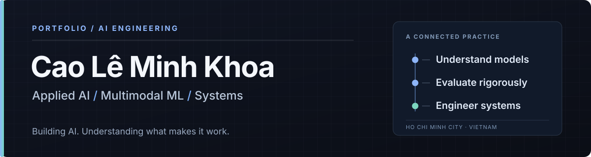

  

  <a href="https://khoalearningcode.github.io/"><strong>Portfolio</strong></a>
  &nbsp;·&nbsp;
  <a href="https://khoalearningcode.github.io/#work">Selected work</a>
  &nbsp;·&nbsp;
  <a href="https://khoalearningcode.github.io/career.html">Experience</a>
  &nbsp;·&nbsp;
  <a href="https://khoalearningcode.github.io/assets/Cao-Le-Minh-Khoa-CV.pdf">CV</a>
  &nbsp;·&nbsp;
  <a href="https://www.linkedin.com/in/cao-khoa-1b09141b8/">LinkedIn</a>
  &nbsp;·&nbsp;
  <a href="mailto:godminhkhoa@gmail.com">Email</a>

## About

I'm **Cao Lê Minh Khoa**, an **AI Engineer** and Computer Science student at **Ho Chi Minh City University of Technology (HCMUT)**.

I work across applied AI systems, multimodal machine learning, and backend engineering. Industry projects have taught me to build around real workflows and operational constraints; research and challenges have taught me to examine model behavior and evaluate results carefully.

My long-term direction is **AI Infrastructure & ML Systems**—deeper work in efficient inference, model serving, and reliable execution. It's a direction I'm developing toward, grounded in hands-on engineering rather than a claim of large-scale infrastructure expertise.

## Selected engineering & research

<table>
  <tr>
    <td width="50%" valign="top">
      
      
<strong>Multi-frame License Plate Recognition</strong> 
      ICPR 2026 LRLPR · Post-competition evaluation

      
Shared visual encoding, autoregressive recognition and step-synchronous ensembling across five low-resolution frames.

      
<strong>82.03% exact-match</strong> on 3,000 released test tracks. <em>Not an official competition rank.</em>

      
<a href="https://khoalearningcode.github.io/projects/lrlpr.html">Read the case study ↗</a>

    </td>
    <td width="50%" valign="top">
      
      
<strong>ViTNumChart</strong> 
      VLSP 2026 · Multimodal numerical reasoning

      
A fine-tuned vision-language model generates executable programs to reason over Vietnamese financial text, tables and charts.

      
<strong>72.46% private Program Accuracy</strong> · #6 private placement, as recorded by the team.

      
<a href="https://khoalearningcode.github.io/projects/vitnumchart.html">Read the case study ↗</a>

    </td>
  </tr>
</table>

**More selected work**

- **[MonoLaDN — ACCV 2026](https://khoalearningcode.github.io/projects/monoladn.html):** Accepted research on monocular 3D object detection. My contribution focused on generating structured 3D reasoning with vision-language models.
- **[AeroEyes — Zalo AI Challenge 2025](https://khoalearningcode.github.io/projects/aeroeyes.html):** Runner-up (joint second place) in the AeroEyes track with team IUH_AIers_K16.
- **[Enterprise RFI & Compliance Intelligence](https://khoalearningcode.github.io/projects/compliance.html):** Evidence-grounded document processing, hybrid retrieval, structured assessments and human review at AgileMark.
- **[AI Customer Support Automation](https://khoalearningcode.github.io/projects/customer-support.html):** Retrieval-grounded support, workflow orchestration and human escalation through Zalo OA at Fizo.

## Experience & direction

| Experience | Focus |
| :-- | :-- |
| **Fizo** · AI Engineer · 2025–present | Backend services and customer-support AI workflows |
| **AgileMark** · Junior AI Engineer · 2026–present | Enterprise document intelligence and AI systems |
| **EyeCode Tech** · AI Researcher Intern · 2026 | Efficient vision-language-action model inference |

**Engineering practice:** Python · PyTorch · multimodal ML · retrieval & RAG · backend APIs · model evaluation · reproducible experiments.

I care about the full path from **model understanding → measured behavior → dependable application**. My [portfolio](https://khoalearningcode.github.io/) includes the detailed case studies, roles, methodology and evidence behind these summaries.

---

  <strong>Interested in building reliable AI systems together?</strong> 
  <a href="mailto:godminhkhoa@gmail.com">Get in touch</a>
  &nbsp;·&nbsp;
  <a href="https://khoalearningcode.github.io/">Visit the portfolio ↗</a>

<!-- A future portrait may be added to the introduction without replacing project evidence. -->
